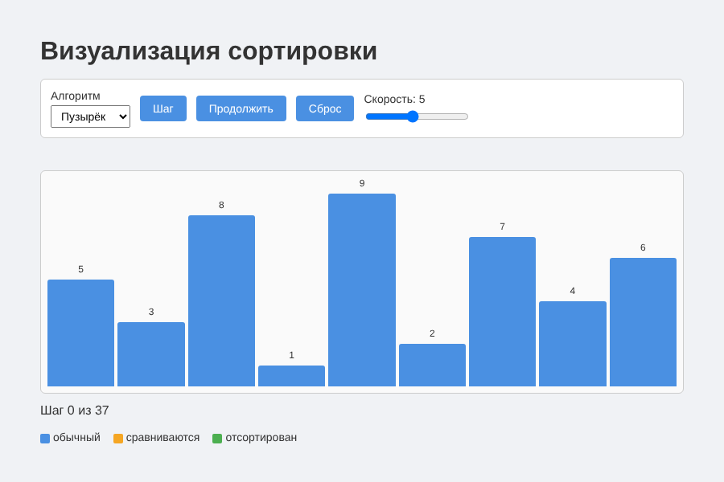
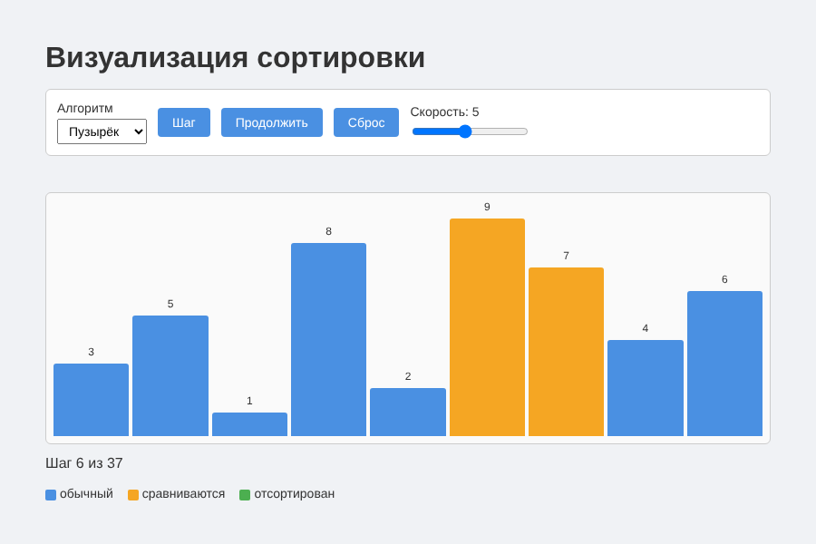
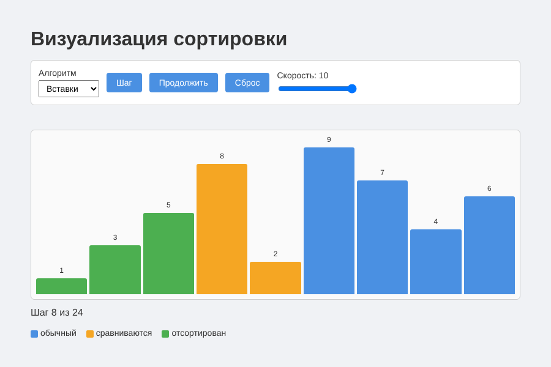
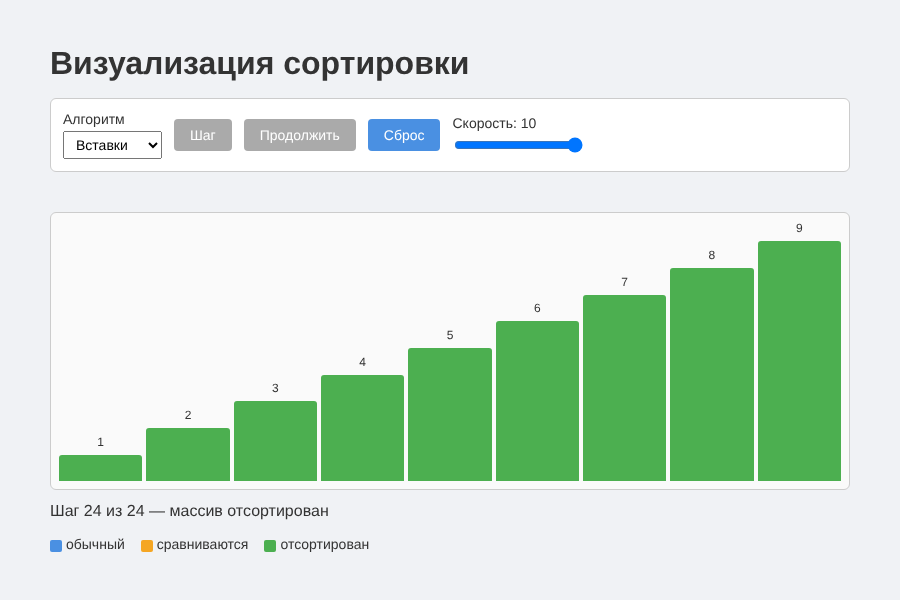

# Визуализатор сортировок (лабораторная работа 4)

Библиотека React-компонентов для визуализации сортировки и демо-приложение, которое её использует.

Решение состоит из двух проектов:

- `ui-library` — библиотека компонентов:
  - `ArrayBars` — панель визуализации массива: столбцы по значениям, подсветка сравниваемых (оранжевый) и уже отсортированных (зелёный) элементов;
  - `ControlPanel` — панель управления: выбор алгоритма, кнопки «Шаг», «Пауза/Продолжить», «Сброс» и ползунок скорости.
- `frontend` — демо-приложение: пошагово сортирует массив пузырьком, вставками или выбором и показывает процесс с помощью компонентов библиотеки.

## Запуск

Сначала соберите библиотеку, затем запустите приложение:

```sh
cd ui-library
npm install
npm run build

cd ../frontend
npm install
npm run dev
```

Приложение откроется по адресу, который выведет Vite (обычно http://localhost:5173).

Проверки (в каждой из папок):

```sh
npm run lint
npm run test
npm run test:coverage
npm run build
```

## Примеры работы

Начальное состояние:



Пошаговый режим — подсвечены сравниваемые элементы:



Пауза во время автовоспроизведения (сортировка вставками):



Массив отсортирован:


